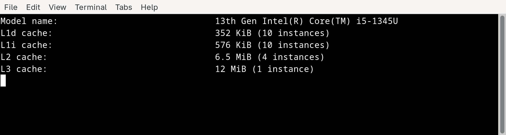
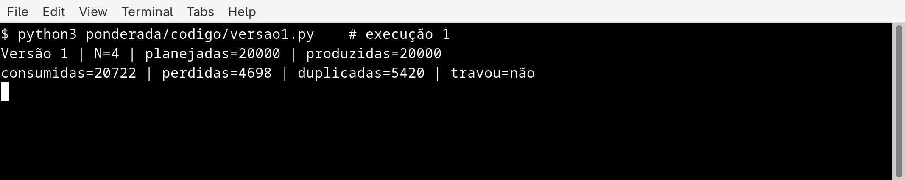
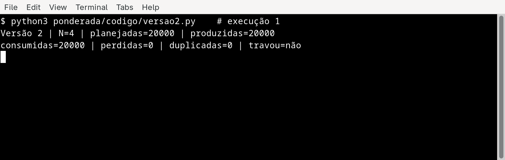
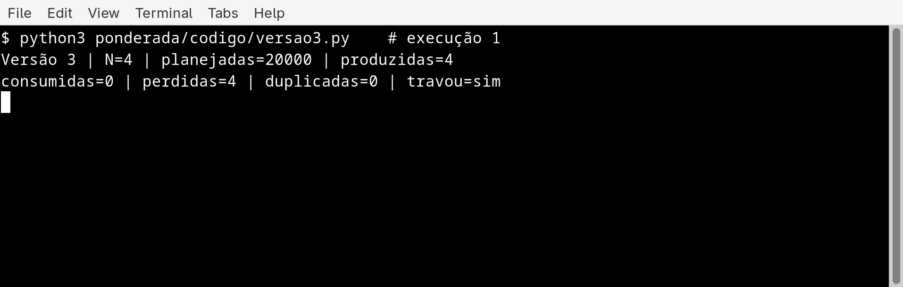
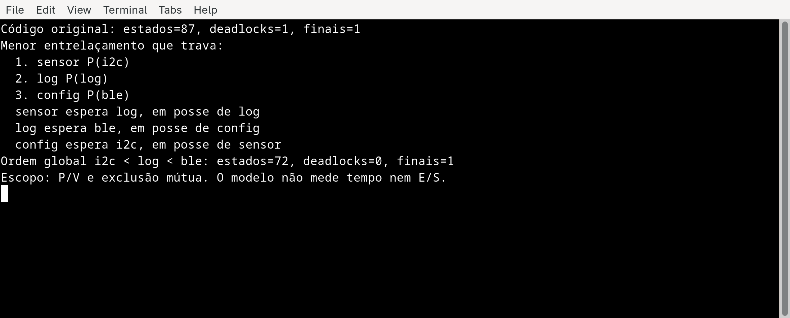
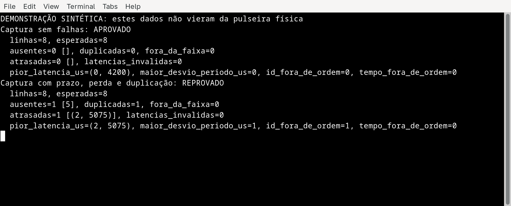
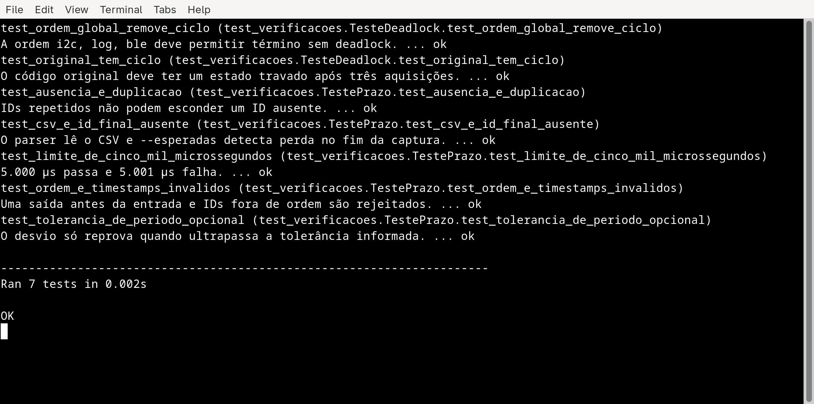

Richard Dias Alves | D1 = 7 | D2 = 6 | N = 4

# Pulseira Tato: do pipeline ao deadlock

Richard tem 7 letras. No nome completo, a conta é Richard (7) + Dias (4) + Alves (5) = 16 letras. Assim, D1 = 7, D2 = 16 mod 10 = 6, IC = 100.000 + 20.000 × 6 = 220.000 instruções por amostra, m = 3% + 0,5% × 7 = 6,5% = 0,065 e N = 3 + (6 mod 5) = 4 posições.

## Parte A: o problema técnico

### A1. Arquitetura e memória

**1. Plataforma H.** São 220.000 × 1,5 = 330.000 ciclos por amostra. A 48 MHz, o tempo é 330.000 / 48.000.000 = 0,006875 s = **6,875 ms**. Excede o limite de 5 ms em 1,875 ms.

**2. Plataforma V.** Tratei os 120 ciclos como penalidade da falta, como pede a fórmula do CPI. O acesso médio à memória fica AMAT = 1 + 0,065 × 120 = **8,8 ciclos**. O CPI efetivo é 1 + (1,3 × 0,065 × 120) = **11,14**. Logo, 220.000 × 11,14 = 2.450.800 ciclos e 2.450.800 / 1.200.000.000 = 0,002042333 s = **2,0423 ms** por amostra. No pior caso informado, somo a interrupção do Linux: 2,0423 + 3 = **5,0423 ms**. Passa do prazo por 0,0423 ms, ou cerca de 42 µs. A média sozinha atenderia, mas o requisito é para cada amostra.

**3. H com DSP.** A fração acelerada é 0,60 e ela fica 5 vezes mais rápida. Pela Lei de Amdahl, speedup = 1 / [(1 - 0,60) + (0,60 / 5)] = 1 / 0,52 = **1,9231**. O novo tempo é 6,875 × 0,52 = **3,575 ms**. Sob as premissas da questão, atende aos 5 ms com folga de 1,425 ms.

**4. Cache e gargalo.** Na V, instruções e dados disputam o caminho até a DRAM. A cache reduz as idas à memória externa, que é lenta frente ao clock de 1,2 GHz. Esse tráfego é o gargalo de Von Neumann. A H usa caminhos separados para instruções e dados e SRAM interna de um ciclo. No modelo dado, não há a mesma espera pela DRAM.

**5. Máquina usada.** O `lscpu` mostrou um Intel Core i5-1345U com L1d de 352 KiB e L1i de 576 KiB, ambos distribuídos em 10 instâncias. Há também L2 de 6,5 MiB e L3 de 12 MiB. A L1 é dividida entre dados e instruções. Código e dados compartilham o espaço da memória principal. Por isso, classifico a máquina como Von Neumann com cache L1 separada, também chamada Harvard modificada.



### A2. Pipeline do filtro

Numerei as instruções na ordem do enunciado. As dependências RAW são **1 → 2 por x5**, **2 → 4 por x6**, **3 → 4 por x7** e **4 → 5 por x6**. A instrução 4 precisa do valor de x6 já atualizado pela 2. A 5 precisa da soma final, depois da subtração.

Nas tabelas, `ID*` e `IF*` indicam estágio parado pelo hazard. O registro escrito em WB pode ser lido em ID no mesmo ciclo, porque a escrita ocorre na primeira metade e a leitura na segunda. `MEM` é o estágio de memória.

**Sem forwarding:**

```text
ciclo    1   2   3   4   5   6   7   8   9  10  11  12  13  14  15  16  17
I1      IF  ID  EX MEM  WB   ·   ·   ·   ·   ·   ·   ·   ·   ·   ·   ·   ·
I2       ·  IF  ID ID* ID*  EX MEM  WB   ·   ·   ·   ·   ·   ·   ·   ·   ·
I3       ·   ·  IF IF* IF*  ID  EX MEM  WB   ·   ·   ·   ·   ·   ·   ·   ·
I4       ·   ·   ·   ·   ·  IF  ID ID* ID*  EX MEM  WB   ·   ·   ·   ·   ·
I5       ·   ·   ·   ·   ·   ·  IF IF* IF*  ID ID* ID*  EX MEM  WB   ·   ·
I6       ·   ·   ·   ·   ·   ·   ·   ·   ·  IF IF* IF*  ID  EX MEM  WB   ·
I7       ·   ·   ·   ·   ·   ·   ·   ·   ·   ·   ·   ·  IF  ID  EX MEM  WB
```

O trecho leva **17 ciclos**, do primeiro IF ao último WB. Sem dependências seriam 7 + 4 = 11 ciclos. As esperas acrescentam 2 ciclos na instrução 2, 2 na 4 e 2 na 5: 11 + 6 = 17.

**Com forwarding:**

```text
ciclo    1   2   3   4   5   6   7   8   9  10  11  12  13
I1      IF  ID  EX MEM  WB   ·   ·   ·   ·   ·   ·   ·   ·
I2       ·  IF  ID ID*  EX MEM  WB   ·   ·   ·   ·   ·   ·
I3       ·   ·  IF IF*  ID  EX MEM  WB   ·   ·   ·   ·   ·
I4       ·   ·   ·   ·  IF  ID ID*  EX MEM  WB   ·   ·   ·
I5       ·   ·   ·   ·   ·  IF IF*  ID  EX MEM  WB   ·   ·
I6       ·   ·   ·   ·   ·   ·   ·  IF  ID  EX MEM  WB   ·
I7       ·   ·   ·   ·   ·   ·   ·   ·  IF  ID  EX MEM  WB
```

São **13 ciclos**, pois restam duas bolhas de um ciclo. A 2 usa o resultado do `lw` da 1 imediatamente. A 4 faz o mesmo com o `lw` da 3. O dado carregado só chega ao fim de MEM, tarde para a EX da instrução seguinte. Assumi também o encaminhamento normal do dado da instrução 4 para o `sw` da 5.

**Nova ordem com forwarding, sem bolhas:**

```text
I1  lw   x5, 0(x10)      # nova
I2  lw   x7, 0(x11)      # antiga
I3  add  x6, x6, x5
I4  addi x10, x10, 4
I5  sub  x6, x6, x7
I6  addi x11, x11, 4
I7  sw   x6, 0(x12)
```

Os dois `lw` ainda usam os endereços antigos, pois cada ponteiro só avança depois de sua leitura. O `sw` continua após a subtração. Há uma instrução independente entre cada carga e seu primeiro uso. A nova sequência percorre IF → ID → EX → MEM → WB sem parada e leva **7 + 4 = 11 ciclos**.

### A3. Processos e threads

Na Plataforma V, colocaria leitura do sensor, filtro e acionamento do motor como três threads de um processo responsável pelo tempo crítico. Elas compartilham o buffer de amostras sem serializar dados para IPC. Threads custam menos para criar e trocar do que processos, embora uma falha de memória em uma delas possa derrubar as três. O BLE ficaria em outro processo, com privilégio restrito. Ele receberia cópias do log por uma fila limitada e enviaria comandos de configuração por IPC com validação. O envio do log nunca deve segurar a thread do motor.

Se uma entrada BLE explorar uma falha em uma thread do processo principal, o invasor ganha acesso ao espaço de memória que contém amostras, estado do filtro e controle do motor. Em processo separado, a memória e as permissões do núcleo ficam isoladas. Ainda preciso validar os comandos recebidos, pois o isolamento não corrige um comando malicioso aceito pelo programa.

```text
NOVO → PRONTO → EXECUTANDO → TERMINADO
          ↑         │
          │         ├─ preempção ─────────→ PRONTO
          │         ↓
          └───── ESPERANDO (timer, E/S ou semáforo)
```

A thread do sensor passa a maior parte do tempo em **espera** pelo próximo período de 10 ms. Depois que o timer a acorda, ela passa por pronta e execução. A espera pode chegar perto de 10 ms por ciclo, enquanto o trabalho da amostra tem prazo máximo de 5 ms. O atraso de escalonamento do Linux na A1 é justamente um risco entre ficar pronta e executar.

### A4. Buffer circular e semáforos

Os programas estão em [`codigo/versao1.py`](codigo/versao1.py), [`codigo/versao2.py`](codigo/versao2.py) e [`codigo/versao3.py`](codigo/versao3.py). Cada execução pediu 20.000 IDs, de 0 a 19.999, com N = 4. Chamei de **perdida** cada amostra produzida cujo ID não apareceu no consumo. **Duplicada** conta cada recebimento além da primeira ocorrência do mesmo ID. Assim, na primeira execução da versão 1, houve 20.000 - 4.698 = 15.302 IDs distintos recebidos e 20.722 - 15.302 = 5.420 leituras repetidas. `Travou` significa 1 segundo sem novo consumo.

| Versão | Execução | Produzidas | Consumidas | Perdidas | Duplicadas | Travou? |
|:---:|:---:|---:|---:|---:|---:|:---:|
| 1 | 1 | 20.000 | 20.722 | 4.698 | 5.420 | Não |
| 1 | 2 | 20.000 | 21.005 | 4.012 | 5.017 | Não |
| 1 | 3 | 20.000 | 21.775 | 3.877 | 5.652 | Não |
| 2 | 1 | 20.000 | 20.000 | 0 | 0 | Não |
| 2 | 2 | 20.000 | 20.000 | 0 | 0 | Não |
| 2 | 3 | 20.000 | 20.000 | 0 | 0 | Não |
| 3 | 1 | 4 | 0 | 4 | 0 | Sim |
| 3 | 2 | 4 | 0 | 4 | 0 | Sim |
| 3 | 3 | 4 | 0 | 4 | 0 | Sim |

O [print das nove execuções](img/a4-nove-execucoes.png) permite conferir cada linha da tabela.

Na versão 3, 20.000 era a meta da chamada, mas o produtor bloqueou após colocar só quatro itens. Os outros 19.996 IDs nem chegaram a ser produzidos. A coluna de perdas conta apenas os quatro IDs já gerados e ainda não entregues.

**Versão 1.** A região crítica reúne o teste de `ocupadas`, a escrita ou leitura na posição do anel, a atualização de `inicio` ou `fim` e a mudança do contador. O `sleep(0)` entre ler e escrever `ocupadas` permite que duas threads usem o mesmo valor antigo. Uma atualização some, o contador deixa de representar o buffer e uma posição pode ser lida duas vezes ou sobrescrita antes do consumo. A GIL do Python não protege essa sequência inteira.

**Versão 2.** `vazio` começa em 4 e reserva espaço antes de produzir. `cheio` começa em 0 e impede consumo antes de haver item. `mutex` começa em 1 e deixa só uma thread alterar o anel e seus índices por vez. O produtor espera `vazio` antes de entrar no `mutex`. O consumidor espera `cheio` antes de entrar no `mutex`. Assim ninguém segura o acesso ao anel enquanto aguarda a outra thread liberar uma vaga ou entregar um item.

**Versão 3.** Atrasei o início do consumidor em 20 ms nas versões 2 e 3, para começar o consumo com o buffer cheio nas duas. A única mudança na lógica do produtor da versão 3 é a ordem dos dois `wait`: ele segura `mutex` e espera `vazio`, que vale zero. O consumidor já tem item em `cheio`, mas precisa do `mutex` para retirá-lo e devolver uma vaga. Os dois ficam à espera um do outro. Os prints abaixo mostram a primeira execução de cada versão. Como a versão 1 depende do escalonamento, seus números podem mudar numa nova rodada.







### A5. Deadlock da pulseira

Uma sequência possível: `thread_sensor` trava `i2c` e lê o sensor. Em seguida, `thread_log` trava `log` e lê o arquivo. Depois, `thread_config` trava `ble` e recebe um comando. O sensor pede `log`, o log pede `ble` e a configuração pede `i2c`. Nenhuma consegue avançar.

```text
i2c ──alocado a──→ sensor ──pede──→ log
log ──alocado a──→ thread_log ──pede──→ ble
ble ──alocado a──→ thread_config ──pede──→ i2c
```

O ciclo completo é sensor → log → thread_log → ble → thread_config → i2c → sensor.

| Condição necessária | Onde aparece |
|---|---|
| Exclusão mútua | Cada semáforo protege um recurso usado por uma thread por vez. |
| Posse e espera | Cada thread guarda o primeiro recurso enquanto pede o segundo. |
| Sem preempção | Outra thread não pode tirar à força `i2c`, `log` ou `ble` da dona. |
| Espera circular | Sensor espera log, log espera configuração e configuração espera sensor. |

**Prevenção.** Defino uma ordem única de aquisição: `i2c`, depois `log`, depois `ble`. A configuração precisaria adquirir `i2c` antes de `ble`. O grafo não formaria o ciclo. Para não trocar deadlock por atraso de vibração, o sensor deve ter prioridade no barramento e as seções críticas precisam de duração medida e limitada. O usuário deixa de sofrer um congelamento permanente, mas comandos recebidos por BLE podem esperar mais.

**Detecção e recuperação.** Coloco limite de espera nos segundos `P`. Se o sensor não pegar `log` em até 0,2 ms, ele solta `i2c`, registra a falha para envio posterior e segue com a vibração da amostra. As outras threads também soltam o que já seguram ao expirar seu prazo e tentam de novo, fora do caminho crítico. Isso quebra a posse e espera no caso observado. Para a pessoa, um registro ou comando pode atrasar ou se perder, mas a vibração não deve esperar pelo log. É preciso medir também quanto tempo a configuração segura `i2c`, pois esse tempo entra no limite real de 5 ms.

**Conferência das ordens de execução.** Além do grafo desenhado, modelei cada `P` e `V` em [`codigo/verificar_deadlock.py`](codigo/verificar_deadlock.py). O programa percorre todos os estados alcançáveis das três threads e dos três recursos. No código original encontrou **87 estados e um estado de deadlock**. O caminho mais curto começa com sensor adquirindo `i2c`, log adquirindo `log` e configuração adquirindo `ble`. Em seguida, cada thread espera o recurso da próxima. Ao trocar a ordem da configuração para `i2c` antes de `ble`, encontrou **72 estados e nenhum deadlock**. A prova vale para a ordem de locks modelada. Tempo de execução, I/O e duração das seções críticas ficam fora desse modelo.



### Fechamento técnico: o prazo de ponta a ponta

A conta de CPU da A1, o buffer da A4 e os locks da A5 precisam caber no **mesmo** prazo. Na H com DSP, o orçamento restante é 5,000 - 3,575 = **1,425 ms** para ler o sensor, atualizar o motor, atender interrupções e esperar recursos. Uma espera de 1,500 ms pelo log levaria a amostra a pelo menos 3,575 + 1,500 = **5,075 ms**, mesmo com o filtro acelerado. O buffer estar correto quanto aos dados não basta para cumprir o prazo.

Também há um limite para aceitar o DSP do fornecedor. Se a aceleração real do filtro for `s` e o restante do caminho consumir `E` ms, então `T = 6,875 × (0,40 + 0,60/s) + E`. Para cumprir o prazo, `s ≥ 0,60 / [(5 - E)/6,875 - 0,40]`. Com `E = 0`, bastaria `s ≥ 1,833`. Com `E = 1,000 ms`, a exigência sobe para `s ≥ 3,300`. Com `E = 1,425 ms`, são necessários os **5,000** prometidos. Eu cobraria essa aceleração no pior caso medido, junto com o tempo de leitura e comando do motor.

A versão 2 da A4 protege os dados, mas seu produtor espera em `vazio` sem limite. Se o consumidor parar logo depois de esvaziar o buffer de quatro posições, chegam amostras em t = 0, 10, 20 e 30 ms. A quinta, em t = 40 ms, encontra o buffer cheio e bloqueia. Esse comportamento é aceitável para demonstrar semáforos, porém impediria a pulseira de cumprir o prazo. No produto, uma falha do consumidor tem de ser detectada dentro do prazo e informada à pessoa, sem deixar o sensor preso nessa espera.

Por isso, o caminho da vibração deve seguir direto de sensor → filtro DSP → motor. O log vai para uma fila de capacidade limitada por uma tentativa sem espera. Quando ela encher, o firmware conta a perda do registro e continua a vibração. Comandos BLE entram apenas em pontos em que a duração de acesso ao `i2c` esteja limitada e medida. Um temporizador de supervisão verifica a conclusão de cada amostra. Ao detectar um atraso, ele tenta comandar um padrão de vibração de erro distinto do aviso de obstáculo. Essa resposta depende de o motor ainda funcionar e precisaria ser validada com usuários.

No protótipo físico, eu marcaria com GPIO o instante em que a amostra fica disponível e o instante em que o motor recebe o novo comando. Um analisador lógico mediria a diferença enquanto a pulseira recebe comandos BLE, envia logs e enche a fila. Cada marca precisa manter o ID da amostra, para uma saída ausente não deslocar o pareamento das próximas. O ensaio de 1.000.000 de amostras a 100 Hz dura 1.000.000 / 100 = **10.000 s = 2 h 46 min 40 s**. O critério de liberação é máximo observado ≤ 5,000 ms, zero IDs perdidos ou duplicados no caminho sensor → motor e zero travamentos. Um ensaio finito não prova todos os futuros casos, por isso também verificaria os entrelaçamentos críticos da A4 e da A5 de forma dirigida. O início físico da vibração também merece medição: o comando do motor pode anteceder a sensação na pele.

Para tornar esse critério executável, fiz [`codigo/validar_prazo.py`](codigo/validar_prazo.py). Ele lê um CSV com `id,sensor_us,motor_us` e o total planejado de amostras. A análise verifica todos os IDs, duplicações, ordem temporal e latência de cada linha, com limite de **5.000 µs**. Também informa o maior desvio do período nominal de **10.000 µs**. Como o enunciado não fixa tolerância de jitter, esse desvio só reprova a captura quando uma tolerância é informada no comando. O programa lê o arquivo linha a linha e foi exercitado com **1.000.000 de linhas sintéticas**.

O modo `--demo` deixa visível como o critério funciona: oito linhas sintéticas com pior latência de 4.200 µs são aprovadas. No segundo caso, o ID 2 demora 5.075 µs, o ID 5 falta e o ID 6 se repete. O resultado é reprovado. **Esses dados não são medições da pulseira.** O CSV de hardware ainda precisaria ser produzido no protótipo e analisado pelo mesmo comando.



Também deixei [sete testes automáticos](codigo/test_verificacoes.py) para os dois programas, cobrindo o ciclo de deadlock, a correção, o limite exato de 5.000 µs, a primeira amostra atrasada em 5.001 µs, IDs ausentes ou repetidos, timestamps inválidos e a tolerância opcional do período. Todos passaram na execução registrada abaixo.



## Parte B: a decisão do CTO

**Memorando ao conselho da Tato | Dilema 2: processador de produção**

Escolho a Plataforma H com DSP para a pulseira de produção. No cálculo da A1 ela processa a amostra em 3,575 ms, com 1,425 ms de folga para o prazo de 5 ms. A H sem DSP leva 6,875 ms. A V leva 2,0423 ms em condições médias, mas alcança 5,0423 ms quando ocorre a interrupção de 3 ms prevista no enunciado. Para quem caminha usando a pulseira, o caso lento é o que decide.

Essa escolha custa R$ 37 por unidade, R$ 15 a mais que a H básica. Ainda fica R$ 33 abaixo da V. Em um lote de 2.000 unidades, a diferença de hardware seria 2.000 × R$ 33 = **R$ 66.000**. Aceito também a atualização de firmware por cabo. A empresa pagará pela estrutura de assistência e pela logística de recolher pulseiras quando uma falha precisar de correção. Se esse atendimento custar mais de R$ 33 por pulseira ao longo da vida útil, a economia de hardware desaparece. A pessoa usuária pode ficar mais tempo com uma versão antiga até ser atendida. Por isso, cada lote precisa sair com firmware versionado, testes de regressão e um procedimento claro de atualização em assistência.

Sem Linux e sem atualização pela internet, há menos componentes expostos remotamente, mas BLE continua recebendo dados externos e exige validação de comandos. Os 1,425 ms são uma estimativa calculada. Ainda falta medir a pulseira pronta. Antes de liberar o lote, vou medir do instante da amostra até o início da vibração, incluindo leitura do sensor, interrupções e concorrência com BLE. Se qualquer amostra passar de **5,000 ms** no ensaio de pior caso, suspendo esta escolha até corrigir o firmware ou trocar a plataforma. Esse é o fato que me faria voltar ao conselho com outra decisão.
